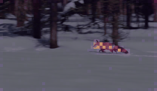
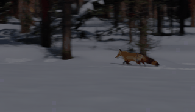

# attention-map-diffusers

Relation-aware attention capture and visualization for Hugging Face Diffusers
image and video pipelines.

[](https://pypi.org/project/attention-map-diffusers/)
[](https://github.com/wooyeolBaek/attention-map-diffusers/actions/workflows/ci.yml)
[](https://doi.org/10.5281/zenodo.18304023)
[](LICENSE)

## Visualization

### Image · FLUX.2 Klein

Prompt: *Editorial wildlife photograph of a red fox wearing round glasses
beside a glowing blue lantern in a snowy pine forest at dusk.*

| text→text | text→image · `lantern` |
| :---: | :---: |
|  |  |
| **image→text · `lantern`** | **image→image · center patch** |
|  |  |

### Video · Wan 2.1 T2V 1.3B

Prompt: *A cinematic tracking shot of a red fox running across pristine snow
in a pine forest, detailed fur, natural winter light, smooth motion, stable camera.*

| video→text · `fox` | video→video · center patch |
| :---: | :---: |
|  |  |

Wan exposes cross-attention (`video→text`) and spatial-temporal self-attention
(`video→video`), so the table shows every relation in its denoiser.

Spatial examples are attention overlays, so the generated source is not shown
again. Video maps preserve the patch grid as `(T,H,W)`; each GIF also has
per-frame PNG output. Spatial labels are off by default.

## Compatible models

Requires `diffusers>=0.39.0`.

| Key | Checkpoint | Relations |
| --- | --- | --- |
| `flux2-klein` | [`black-forest-labs/FLUX.2-klein-4B`](https://huggingface.co/black-forest-labs/FLUX.2-klein-4B) | image/text all |
| `z-image-turbo` | [`Tongyi-MAI/Z-Image-Turbo`](https://huggingface.co/Tongyi-MAI/Z-Image-Turbo) | image/text all |
| `prx-pixel` | [`Photoroom/prxpixel-t2i`](https://huggingface.co/Photoroom/prxpixel-t2i) | image→text, image→image |
| `flux-schnell` | [`black-forest-labs/FLUX.1-schnell`](https://huggingface.co/black-forest-labs/FLUX.1-schnell) | image/text all |
| `flux-dev` | [`black-forest-labs/FLUX.1-dev`](https://huggingface.co/black-forest-labs/FLUX.1-dev) | image/text all |
| `sd3-5` | [`stabilityai/stable-diffusion-3.5-medium`](https://huggingface.co/stabilityai/stable-diffusion-3.5-medium) | image/text all |
| `sd3` | [`stabilityai/stable-diffusion-3-medium-diffusers`](https://huggingface.co/stabilityai/stable-diffusion-3-medium-diffusers) | image/text all |
| `sana` | [`Efficient-Large-Model/Sana_1600M_1024px_diffusers`](https://huggingface.co/Efficient-Large-Model/Sana_1600M_1024px_diffusers) | image→text, image→image |
| `sdxl` | [`stabilityai/stable-diffusion-xl-base-1.0`](https://huggingface.co/stabilityai/stable-diffusion-xl-base-1.0) | image→text, image→image |
| `sd` | [`sd2-community/stable-diffusion-2-1`](https://huggingface.co/sd2-community/stable-diffusion-2-1) | image→text, image→image |
| `cogvideox-2b` | [`THUDM/CogVideoX-2b`](https://huggingface.co/THUDM/CogVideoX-2b) | video/text all |
| `wan2.1-t2v-1.3b` | [`Wan-AI/Wan2.1-T2V-1.3B-Diffusers`](https://huggingface.co/Wan-AI/Wan2.1-T2V-1.3B-Diffusers) | video→text, video→video |
| `hunyuan-video-1.5` | [`hunyuanvideo-community/HunyuanVideo-1.5-Diffusers-480p_t2v`](https://huggingface.co/hunyuanvideo-community/HunyuanVideo-1.5-Diffusers-480p_t2v) | video/text all |

“image/text all” is text→text, text→image, image→text, and image→image.
“video/text all” is text→text, text→video, video→text, and video→video.

## Install

```bash
pip install --upgrade attention-map-diffusers
```

## Image quick start

```python
import torch
from diffusers import Flux2KleinPipeline
from attention_map_diffusers import AttentionCapture, text_tokenizers

prompt = "A red fox beside a glowing blue lantern in a snowy forest."
pipe = Flux2KleinPipeline.from_pretrained(
    "black-forest-labs/FLUX.2-klein-4B", torch_dtype=torch.bfloat16
).to("cuda")

with AttentionCapture(
    pipe,
    relations=["text->text", "text->image", "image->text", "image->image"],
    offload="cuda",
) as capture:
    images = pipe(prompt=[prompt], num_inference_steps=4).images

capture.compute().save(
    "outputs/attention", tokenizer=text_tokenizers(pipe),
    prompts=[prompt], images=images,
)
```

## Video quick start

```python
import torch
from diffusers import WanPipeline
from attention_map_diffusers import AttentionCapture, VisualizationConfig, text_tokenizers

prompt = "A cinematic tracking shot of a red fox running across snow in a pine forest."
steps = 50
pipe = WanPipeline.from_pretrained(
    "Wan-AI/Wan2.1-T2V-1.3B-Diffusers", torch_dtype=torch.bfloat16
).to("cuda")
pipe.scheduler.set_timesteps(steps, device="cuda")
last_timestep = [float(pipe.scheduler.timesteps[-1])]

with AttentionCapture(
    pipe,
    relations=["video->text", "video->video"],
    timesteps=last_timestep,
    relation_query_indices={"video->video": "center"},
    offload="cpu",
    max_capture_bytes=16 * 1024**3,
) as capture:
    videos = pipe(
        prompt=[prompt], num_inference_steps=steps,
        height=480, width=832, num_frames=81,
    ).frames

for component in pipe.components.values():
    if isinstance(component, torch.nn.Module):
        component.to("cpu")
torch.cuda.empty_cache()
capture.compute(compute_device="cuda").save(
    "outputs/attention", tokenizer=text_tokenizers(pipe),
    prompts=[prompt], videos=videos,
    visualization_config=VisualizationConfig(max_items=16, video_fps=16),
)
```

The shared runner contains native model defaults and reproducible metadata:

```bash
python demo/run_attention_demo.py --model flux2-klein --relations all
python demo/run_attention_demo.py --model wan2.1-t2v-1.3b --relations all
```

## Output and controls

```text
attention/
  metadata.json                         # provenance + capture settings
  raw/<relation>/*.pt                   # only with --save-raw
  raw-components/<relation>/<encoder>/ # token-concatenated encoders
  visuals/<relation>/aggregate/batch-000/
    maps/*.png                          # image attention
    maps/*.gif                          # video attention
    maps/<encoder>/*                    # token-concatenated encoders
    maps/<item>/frames/*.png
    overlays/                           # generated-media overlays, separate
```

- The final timestep and head mean are retained by default.
- Use `--capture-timesteps all` and `--save-layer-maps` for every timestep and
  layer. The default 8 GiB cumulative capture guard prevents silent RAM/VRAM
  exhaustion.
- Every image→image query patch is rendered by default. Video→video defaults to
  the center query patch because a full `(query T×H×W)²` tensor is impractical;
  use `--large-relation-query-indices sample:9` or `all` explicitly.
- Raw `.pt` tensors are optional and are never required for visualization.
- CFG stored as separate denoiser calls (HunyuanVideo 1.5) is tagged per call;
  visualizations use the conditional call by default while raw capture keeps both.
- Token-axis concatenation is preserved. SD3 saves fused-CLIP and T5 maps
  separately (including all four text→text component pairs); HunyuanVideo 1.5
  separates ByT5 and MLLM after its mask-based token reordering and records its
  two MLLM token-refiner layers as MLLM→MLLM maps. Feature-axis fusion such as
  SDXL CLIP-L+G remains one mathematically inseparable map.
- Capture fails with a layer/processor report if any denoiser attention module
  is unsupported, preventing silently incomplete results.
- Use `--show-spatial-labels` only when token/patch titles are wanted.

## Validation

```bash
python -m pytest -q
python demo/run_attention_demo.py --model all --relations all --dry-run
python demo/audit_attention_coverage.py --model all
python demo/validate_generation_parity.py --model cogvideox-2b --num-frames 9
```

## Citation

```bibtex
@software{baek_attention_map_diffusers_2026,
  author = {Baek, Wooyeol and Baek, Seungyeol},
  title = {attention-map-diffusers},
  version = {1.0.0},
  year = {2026},
  publisher = {Zenodo},
  doi = {10.5281/zenodo.18304023},
  url = {https://doi.org/10.5281/zenodo.18304023}
}
```

[MIT License](LICENSE) · [CITATION.cff](CITATION.cff)
