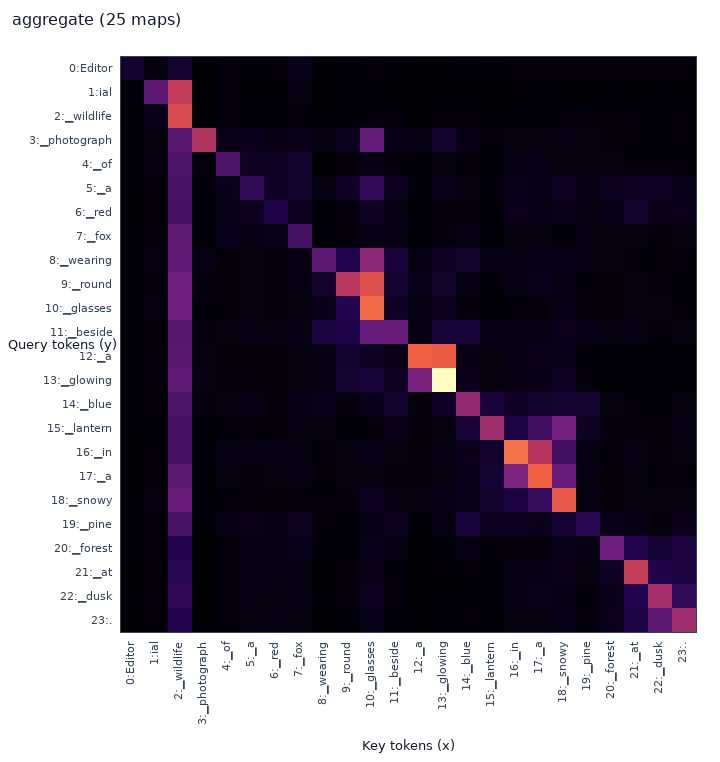
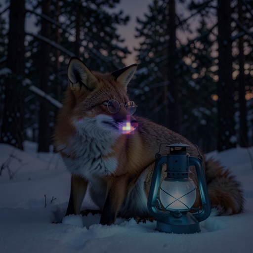

# attention-map-diffusers

Relation-aware attention visualization for Hugging Face Diffusers
image-generation pipelines.

[](https://pypi.org/project/attention-map-diffusers/)
[](https://pypi.org/project/attention-map-diffusers/)
[](https://doi.org/10.5281/zenodo.18304023)
[](LICENSE)

## Visualization

Generated with [`black-forest-labs/FLUX.2-klein-4B`](https://huggingface.co/black-forest-labs/FLUX.2-klein-4B)
at 1024×1024, 4 steps, seed `2026`.

> Editorial wildlife photograph of a red fox wearing round glasses beside a
> glowing blue lantern in a snowy pine forest at dusk.


| text→text | text→image · query token `lantern` |
| :---: | :---: |
|  |  |
| **image→text · key token `lantern`** | **image→image · center query patch** |
|  |  |

Attention is averaged across heads and 25 layers at denoising timestep
`0.96875` (step 2 of 4). Spatial maps are image-only overlays by default;
map-only PNGs are saved alongside them.

| Relation | Visualization |
| --- | --- |
| `text→text` | Token matrix with query tokens on y and key tokens on x |
| `text→image` | Image-shaped heatmap for each query token |
| `image→text` | Image-shaped heatmap for each key token |
| `image→image` | Key-patch heatmap for every selected query patch |

## Compatible models

Requires `diffusers>=0.39.0`.

| Demo key | Diffusers checkpoint | Relations |
| --- | --- | --- |
| `flux2-klein` | [`black-forest-labs/FLUX.2-klein-4B`](https://huggingface.co/black-forest-labs/FLUX.2-klein-4B) | All four |
| `z-image-turbo` | [`Tongyi-MAI/Z-Image-Turbo`](https://huggingface.co/Tongyi-MAI/Z-Image-Turbo) | All four |
| `prx-pixel` | [`Photoroom/prxpixel-t2i`](https://huggingface.co/Photoroom/prxpixel-t2i) | `image→text`, `image→image` |
| `flux-schnell` | [`black-forest-labs/FLUX.1-schnell`](https://huggingface.co/black-forest-labs/FLUX.1-schnell) | All four |
| `flux-dev` | [`black-forest-labs/FLUX.1-dev`](https://huggingface.co/black-forest-labs/FLUX.1-dev) | All four |
| `sd3-5` | [`stabilityai/stable-diffusion-3.5-medium`](https://huggingface.co/stabilityai/stable-diffusion-3.5-medium) | All four |
| `sd3` | [`stabilityai/stable-diffusion-3-medium-diffusers`](https://huggingface.co/stabilityai/stable-diffusion-3-medium-diffusers) | All four |
| `sana` | [`Efficient-Large-Model/Sana_1600M_1024px_diffusers`](https://huggingface.co/Efficient-Large-Model/Sana_1600M_1024px_diffusers) | `image→text`, `image→image` |
| `sdxl` | [`stabilityai/stable-diffusion-xl-base-1.0`](https://huggingface.co/stabilityai/stable-diffusion-xl-base-1.0) | `image→text`, `image→image` |
| `sd` | [`sd2-community/stable-diffusion-2-1`](https://huggingface.co/sd2-community/stable-diffusion-2-1) | `image→text`, `image→image` |

“All four” means `text→text`, `text→image`, `image→text`, and `image→image`.

## Install

```bash
pip install --upgrade attention-map-diffusers
```

For demos and validators:

```bash
git clone https://github.com/wooyeolBaek/attention-map-diffusers.git
cd attention-map-diffusers
pip install -e .
```

## Quick start

```python
import torch
from diffusers import Flux2KleinPipeline
from attention_map_diffusers import AttentionCapture, VisualizationConfig

prompt = (
    "Editorial wildlife photograph of a red fox wearing round glasses beside "
    "a glowing blue lantern in a snowy pine forest at dusk."
)
pipe = Flux2KleinPipeline.from_pretrained(
    "black-forest-labs/FLUX.2-klein-4B",
    torch_dtype=torch.bfloat16,
).to("cuda")

with AttentionCapture(
    pipe,
    relations=["text->text", "text->image", "image->text", "image->image"],
    mode="fast",
    heads="mean",
    offload="cuda",
) as capture:
    images = pipe(
        prompt=[prompt],
        num_inference_steps=4,
        guidance_scale=1.0,
    ).images

maps = capture.compute()
maps.save(
    "outputs/attention",
    tokenizer=pipe.tokenizer,
    prompts=[prompt],
    images=images,
    visualization_config=VisualizationConfig(),
)
```

Or use the shared model runner:

```bash
python demo/run_attention_demo.py \
  --model flux2-klein \
  --relations all \
  --mode fast \
  --offload cuda
```

## Output

```text
outputs/
  metadata.json
  raw/<relation>/*.pt                    # optional
  visuals/<relation>/
    aggregate/batch-000/
      maps/*.png
      overlays/*.png
    steps/<timestep>/<layer>/            # optional
```

- All image query/key patches are retained by default. Use
  `--large-relation-query-indices sample:9` to limit image→image outputs.
- Aggregate attention is saved by default. Add `--capture-timesteps all` and
  `--save-layer-maps` for every timestep and layer.
- Use `--heads mean`, `--heads all`, or a selection such as `--heads 0,2`.
- Raw `.pt` tensors are not required for visualization and are only written
  with `--save-raw`.
- Maps and generated-image overlays are stored in separate directories.
- Spatial PNGs contain only the image by default. Use `--show-spatial-labels`
  or `VisualizationConfig(show_spatial_labels=True)` to add token/patch titles.

See every runner option with:

```bash
python demo/run_attention_demo.py --help
```

## Validation

All ten model integrations were tested on real weights across capture modes,
relations, timesteps, layers, heads, patch selections, raw output, PNG
integrity, and generation parity.

```bash
pytest -q
python demo/validate_generation_parity.py --model all
python demo/validate_option_matrix.py option-matrix-outputs
```

## Citation

```bibtex
@software{baek_attention_map_diffusers_2026,
  author = {Baek, Wooyeol and Baek, Seungyeol},
  title = {attention-map-diffusers},
  version = {1.0.0},
  year = {2026},
  publisher = {Zenodo},
  doi = {10.5281/zenodo.18304023},
  url = {https://doi.org/10.5281/zenodo.18304023}
}
```

See [`CITATION.cff`](CITATION.cff) for machine-readable citation metadata.

## License

[MIT](LICENSE)
